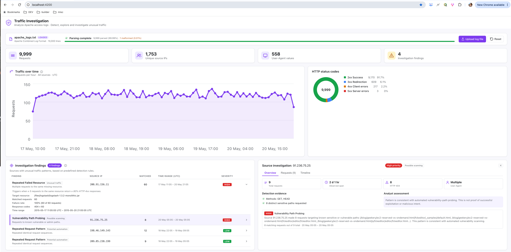

# Traffic Investigation

A lightweight Angular application for security engineers to investigate Apache access logs, understand unusual traffic patterns, and assess whether a source's behavior suggests automation.

A project developed for the DataDome Senior Frontend Engineer technical assessment

**Author:** Valeriya Lebedev

[GitHub](https://github.com/valeriyalebedev) · [LinkedIn](https://www.linkedin.com/in/valeriya-lebedev/)



## Approach

My priority was to build one coherent investigation workflow rather than a generic dashboard with many incomplete features. The goal is to let an engineer upload a log file, review traffic patterns, select a suspicious source, and understand why its behavior may warrant further investigation.

The application answers four questions about each traffic source:

- **Who generated the traffic?** — source IP, request count, User-Agent.
- **When did it happen?** — time range, request timeline with gap detection.
- **How did the source behave?** — methods, status codes, targeted paths, repeated patterns.
- **Does the behavior suggest automation?** — detection findings with evidence and analyst assessment.

## Investigation Workflow

1. **Upload** an Apache access log file. The parser validates each line, preserves original line numbers, and reports malformed records without rejecting the dataset.
2. **Review the overview** — KPI cards (requests, unique IPs, User-Agents, findings), traffic over time chart, and HTTP status code breakdown.
3. **Review detection findings** — three heuristic rules run automatically. Each finding shows the matched rule, severity, evidence count, and a behavioral tag.
4. **Select a finding** to investigate the source IP. The source investigation panel has three tabs:
   - **Overview** — request count, observed time span, top status code, User-Agent, behavioral indicators, and an analyst assessment.
   - **Requests** — full request log for that IP, with evidence rows highlighted. Filter between all requests and matched-only.
   - **Timeline** — chronological request timeline with gap markers (gaps >= 60 seconds).

Every finding references actual log records with preserved line numbers. Behavioral tags ("Possible scanning", "Unusual traffic", "Potential automation") describe the observed pattern, not a verdict. The analyst assessment combines rule context with User-Agent identification (15 known automation tools: Chef Client, curl, wget, Python requests, etc.) to help interpret intent.

## Detection Rules

Three detection heuristics run automatically when a dataset is loaded. These are simplified pattern-matching rules that identify suspicious or potentially automated behavior, not confirmed bots or malicious activity.

**Severity is an investigation priority, not a probability of malicious intent.** Missing User-Agent and HTTP 404 responses alone never trigger findings. IP addresses identify traffic sources, not individual users.

### VULNERABILITY_PATH_PROBING

Detects repeated requests to known sensitive or vulnerable URL paths (e.g. `/phpmyadmin/`, `/.env`, `/wp-login.php`).

- **Threshold:** >= 3 requests to sensitive paths from the same IP.
- **Path matching:** case-insensitive, query parameters stripped. Directory paths use prefix matching; file paths use exact match.
- **Severity:** high at 10+ hits or 5+ distinct paths, medium at 5+ hits or 3+ paths, low otherwise.
- **Limitation:** relies on a predefined list of sensitive paths. New attack paths are not detected (in this version). Response codes are not considered, requests returning 200 count equally with 404.

### REPEATED_FAILED_RESOURCE

Detects repeated failed requests to the same resource from the same IP.

- **Threshold:** >= 5 requests to the same normalized path, with >= 80% HTTP 4xx responses.
- **Failure definition:** only 4xx responses; 5xx is excluded.
- **Severity:** high at 15+ requests with 95%+ failure rate, medium at 10+ requests or 90%+ rate, low otherwise.
- **Limitation:** path normalization strips query parameters and case, but structurally similar paths with different segments are treated as different resources. Cannot distinguish a misconfigured crawler from intentional probing.

### REPEATED_REQUEST_PATTERNS

Detects repeated consecutive request sequences from the same IP.

- **Threshold:** >= 3 consecutive repetitions of an ordered sequence of >= 3 method + normalized path pairs.
- **Sequence requirements:** must contain more than one unique step (three identical individual requests are not a sequence). Paths normalized to lowercase without query parameters.
- **Severity:** high at 5+ repetitions with sequences of 4+, medium at 4+ repetitions or sequences of 5+, low otherwise.
- **Limitation:** detects exact consecutive repetitions only. Similar recurring behavior with occasional interruptions or unrelated requests interspersed will not be detected.

## Interpreting Findings

A finding is not proof of malicious activity. Each finding should be evaluated in context:

- **Evidence records** are the actual log lines that matched the rule. Line numbers trace back to the original file.
- **Behavioral tags** describe what was observed, not what it means. "Possible scanning" means the source hit known sensitive paths, it does not confirm an attack.
- **Analyst assessment** combines the detection rule with User-Agent context. For example, REPEATED_FAILED_RESOURCE from a Chef Client suggests automated retrieval or client misconfiguration rather than malicious intent.
- **Severity** reflects investigation priority (how unusual the pattern is), not confidence that the source is malicious.

Further investigation and additional signals beyond access logs are required for reliable classification.

## Tech Stack

- Angular 22.2 (standalone components, signals)
- TypeScript 6.0 (strict mode)
- Vitest 5.0
- SCSS

## Getting Started

```bash
npm install
npm start       # development server at http://localhost:4200
npm test
npm run build   # production build
```

A sample log file is included at `public/sample-data/apache_logs.txt` and can be loaded directly in the browser.

## Technical Decisions

**Client-side parsing.** The supplied dataset contains ~10,000 lines. Client-side parsing keeps the application self-contained without backend infrastructure. Performance with larger files has not been benchmarked.

**Pure function architecture.** Parsing, aggregation, detection, and assessment logic are implemented as pure functions independent of Angular. This separates testable domain logic from presentation and makes detection rules individually testable.

**Parser design.** Supports Apache Combined Log Format. Malformed records are rejected rather than partially parsed, but retain their original line numbers and content. Timestamp validation includes calendar dates and timezone offsets.

**No NgRx, Web Workers, or streaming.** These would add complexity without a demonstrated need at the current dataset scale.

**Adaptive time bucketing.** The traffic over time chart selects a bucket interval from 1 minute to 1 day to produce ~50–100 data points, keeping the chart readable regardless of dataset size. Bucketing is applied for visualization only; original records are preserved.

## Implementation Steps

- [x] Set up the Angular project and development environment.
- [x] Implement the Apache Combined Log Format parser with validation.
- [x] Add parser unit tests and validate against the supplied dataset.
- [x] Add file upload and connect it to the parser.
- [x] Aggregate traffic by source IP, including request counts, status codes, methods, and time ranges.
- [x] Build a chronological investigation view for a selected source.
- [x] Implement explainable detection rules for vulnerability path probing, repeated failed resources, and repeated request patterns.
- [x] Bring the investigation workflow together in one accessible, responsive screen.

## Testing

The project includes 164 unit tests across 11 test files, covering the main data-processing and application logic.

The current test suite covers:

- **Log parsing:** valid and malformed Apache Combined Log Format records, timestamp validation, and parsing edge cases.
- **Dataset management:** file loading, sample dataset loading, error handling, reset behavior, and state transitions.
- **Traffic aggregation:** grouping by source IP, HTTP status codes, and adaptive time buckets.
- **Request investigation:** chronological ordering and request history for individual source IPs.
- **Detection rules:** heuristic thresholds, evidence matching, severity assignment, and repeated request patterns.
- **Assessment logic:** interpretation of detection findings and User-Agent identification.

The current suite focuses primarily on unit-level validation of parsing, domain logic, and data processing. Broader integration, end-to-end, and accessibility testing are potential areas for future development.

## Known Limitations

- Detection rules are heuristics with a predefined path list and fixed thresholds. They can produce false positives and false negatives.
- The supplied dataset contains sparse observations (~minute :05 of each hour, May 17–20, 2015), not continuous traffic. Real traffic spikes cannot be reliably inferred.
- Client-side parsing has not been benchmarked for files significantly larger than 10,000 lines.
- The investigation-section SCSS exceeds the project's 7 kB style budget warning (currently 9.4 kB).
- No dark mode support.

## Possible Next Steps

- Detect recurring behavioral patterns that tolerate interruptions and variations, combining sequence similarity with timing regularity.
- Add a REQUEST_BURST rule for detecting traffic spikes from a single source.
- Benchmark parsing performance with larger log files and add Web Workers if needed.
- Consolidate the investigation section styles to reduce the CSS budget.
- Expanded Testing Strategy. The current implementation focuses on unit tests for parsing, aggregation, detection rules, and assessment logic.  Further testing would improve confidence in the application as a complete investigation workflow.

## AI Usage

I used Claude Code to assist with implementation and test creation, and ChatGPT to discuss architecture and review technical decisions. I made the scope and technical decisions, reviewed the generated code, and validated the test and dataset results.
